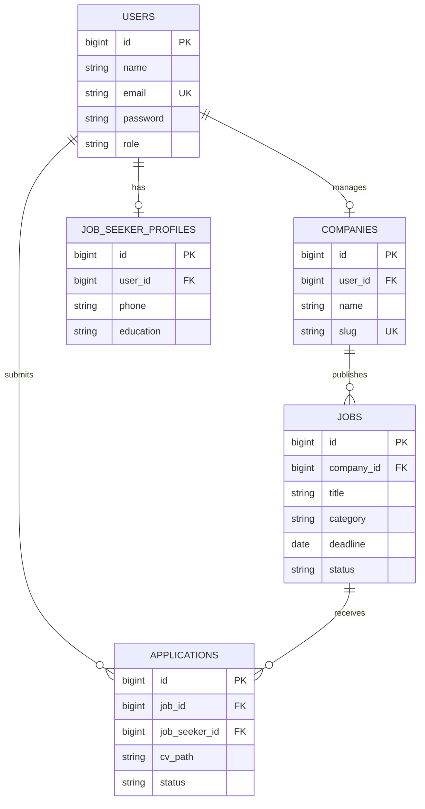

# PROJECT BLUEPRINT
## CV Maju Berkah — Company Profile & Career Management System

> **Dokumen acuan utama proyek UTP Pemrograman Web Lanjut (PWL).**  
> Semua anggota tim wajib menggunakan dokumen ini sebagai sumber kebenaran bersama. Jika ada perubahan fitur, struktur database, nama field, route, status, atau aturan bisnis, sepakati bersama dan perbarui dokumen ini sebelum implementasi yang berbeda dilakukan.

---

## 1. Informasi Proyek

| Item | Keputusan |
|---|---|
| Nama perusahaan | CV Maju Berkah |
| Nama proyek | Company Profile & Career Management System |
| Jenis sistem | Website company profile dengan portal karier dan dashboard rekrutmen |
| Tujuan utama | Memperkenalkan perusahaan fiktif dan mengelola lowongan serta lamaran kerja secara online |
| Framework | Laravel 12 |
| Database | PostgreSQL |
| Bahasa antarmuka | Bahasa Indonesia |
| Zona waktu aplikasi | Asia/Jakarta |
| Role pengguna | `company_admin`, `job_seeker` |
| Target pengguna | Pengunjung publik, admin perusahaan, pencari kerja |
| Status dokumen | Baseline awal — perubahan harus disepakati tim |

### Ringkasan satu kalimat

Website resmi CV Maju Berkah yang menampilkan profil perusahaan dan lowongan kerja, serta menyediakan dashboard bagi admin perusahaan untuk mengelola lowongan dan lamaran, dan bagi pencari kerja untuk mengelola profil serta lamaran miliknya.

---

## 2. Latar Belakang dan Tujuan

CV Maju Berkah adalah **perusahaan fiktif untuk kebutuhan akademik**, bergerak di bidang distribusi barang dan penyediaan kebutuhan usaha. Website dibuat untuk:
1. Menyediakan informasi perusahaan, layanan, visi-misi, dan kontak.
2. Menampilkan lowongan kerja yang masih aktif kepada publik.
3. Memungkinkan pencari kerja mendaftar, login, mengirim CV, dan memantau status lamaran.
4. Memungkinkan admin perusahaan mengelola lowongan dan memproses lamaran.
5. Menerapkan autentikasi, otorisasi, validasi, CRUD, dan penanganan error dalam Laravel.

### Di luar cakupan (tidak dikerjakan kecuali tim menyetujui perubahan)

- Pembayaran, langganan, atau fitur premium.
- Chat langsung antara pelamar dan perusahaan.
- Rekomendasi lowongan berbasis AI.
- Integrasi dengan perusahaan atau lowongan sungguhan.
- Multi-perusahaan / banyak akun perusahaan dengan data perusahaan terpisah.
- Email otomatis/SMS/WhatsApp gateway.
- Sistem tes online, psikotes, atau penjadwalan wawancara.
- API mobile terpisah.

---

## 3. Konsep Perusahaan dan Konten

### 3.1 Profil fiktif

- **Nama:** CV Maju Berkah
- **Bidang:** Distribusi barang dan penyediaan kebutuhan usaha
- **Deskripsi singkat:** Perusahaan yang membantu toko, UMKM, dan mitra bisnis memenuhi kebutuhan produk melalui layanan distribusi dan pengelolaan persediaan.
- **Tagline:** “Bertumbuh Bersama, Melangkah Lebih Maju.”
- **Catatan:** Semua identitas, alamat, kontak, statistik, dan lowongan adalah data fiktif untuk demo akademik. Jangan menampilkan nomor telepon, alamat, atau lowongan nyata milik pihak lain tanpa izin.

Konten visi, misi, layanan, alamat, dan kontak dapat dibuat secara wajar oleh tim. Jangan sampai tiap halaman memakai nama perusahaan, tagline, atau deskripsi yang berbeda.

### 3.2 Bahasa dan gaya penulisan

- Gunakan Bahasa Indonesia yang jelas dan konsisten.
- Gunakan ejaan yang rapi, tidak bercampur istilah secara acak.
- Istilah teknis seperti *Dashboard*, *Login*, dan *Upload CV* boleh dipakai bila konsisten.
- Semua halaman harus menggunakan nama **CV Maju Berkah**.

---

## 4. Role dan Hak Akses

Sistem hanya memiliki **dua role yang bisa login**. Pengunjung publik tidak dihitung sebagai role akun.

### 4.1 Pengunjung publik (tanpa login)

Boleh:
- Membuka beranda, profil, layanan, kontak, daftar lowongan, dan detail lowongan aktif.
- Mencari dan memfilter lowongan aktif.
- Membuka halaman login dan registrasi.

Tidak boleh:
- Mengirim lamaran sebelum login.
- Membuka dashboard privat.
- Mengakses data profil, CV, atau lamaran pengguna lain.

### 4.2 `company_admin` — Admin Perusahaan

Boleh:
- Mengakses dashboard admin perusahaan.
- Melihat dan mengubah profil perusahaan yang dikelola.
- Membuat, melihat, mengubah, dan menghapus/menutup lowongan milik perusahaan.
- Melihat lamaran untuk lowongan perusahaan.
- Mengubah status lamaran.
- Melihat ringkasan jumlah lowongan dan lamaran.

Tidak boleh:
- Mengelola lowongan atau lamaran di luar perusahaan yang ditetapkan untuk akun tersebut.
- Mengubah profil pencari kerja seolah-olah milik pencari kerja.
- Mengakses dashboard pencari kerja sebagai pemilik akun lain.

### 4.3 `job_seeker` — Pencari Kerja

Boleh:
- Mengakses dashboard pencari kerja.
- Melihat dan mengubah profil miliknya.
- Melihat lowongan aktif dan detailnya.
- Mengirim lamaran untuk lowongan aktif sebelum deadline.
- Melihat daftar dan detail lamaran miliknya.
- Mengubah data lamaran atau menarik lamaran selama status masih `pending`.

Tidak boleh:
- Mengubah atau menarik lamaran setelah status bukan `pending`.
- Mengubah status seleksi lamaran sendiri.
- Mengubah lowongan.
- Melihat CV atau data lamaran pengguna lain.

### 4.4 Aturan autentikasi

- Registrasi publik hanya menghasilkan akun `job_seeker`.
- Akun `company_admin` dibuat melalui seeder atau secara manual oleh tim untuk demo; publik tidak dapat memilih role admin saat registrasi.
- Password disimpan menggunakan hashing Laravel, bukan teks biasa.
- Setelah login, arahkan pengguna ke dashboard sesuai role.
- Logout mengakhiri sesi autentikasi.
- Semua route privat harus dilindungi middleware autentikasi dan pemeriksaan role.

---

## 5. Ruang Lingkup Fitur

### 5.1 Fitur publik — Company Profile

| ID | Halaman/fitur | Keterangan |
|---|---|---|
| PUB-01 | Beranda | Hero section, tagline, ringkasan perusahaan, CTA ke lowongan |
| PUB-02 | Tentang perusahaan | Deskripsi, sejarah singkat, visi dan misi |
| PUB-03 | Layanan | Layanan distribusi dan dukungan kebutuhan usaha |
| PUB-04 | Kontak | Informasi kontak fiktif dan/atau form kontak sederhana (opsional) |
| PUB-05 | Daftar lowongan | Hanya lowongan berstatus aktif dan belum melewati deadline |
| PUB-06 | Detail lowongan | Deskripsi, persyaratan, lokasi, tipe kerja, deadline, gaji opsional |
| PUB-07 | Pencarian/filter | Cari berdasarkan judul dan/atau kategori/lokasi |
| PUB-08 | Login/registrasi | Form autentikasi dengan validasi dan pesan error |

### 5.2 Fitur Admin Perusahaan

| ID | Fitur | Keterangan |
|---|---|---|
| ADM-01 | Dashboard | Ringkasan lowongan aktif, lowongan ditutup, total lamaran, lamaran pending |
| ADM-02 | Profil perusahaan | Lihat dan ubah profil perusahaan |
| ADM-03 | CRUD lowongan | Create, Read, Update, Delete/Close lowongan |
| ADM-04 | Daftar pelamar | Melihat lamaran untuk lowongan perusahaan |
| ADM-05 | Detail lamaran | Melihat informasi pelamar dan membuka/mengunduh CV dengan aman |
| ADM-06 | Status lamaran | Mengubah status dari pending ke processing/accepted/rejected sesuai aturan |
| ADM-07 | Validasi dan error | Pesan validasi yang jelas; halaman error yang ramah pengguna |

### 5.3 Fitur Pencari Kerja

| ID | Fitur | Keterangan |
|---|---|---|
| JS-01 | Dashboard | Ringkasan jumlah lamaran berdasarkan status |
| JS-02 | Profil pencari kerja | Lihat dan ubah data diri |
| JS-03 | Kirim lamaran | Isi surat pengantar singkat dan unggah CV PDF |
| JS-04 | Riwayat lamaran | Melihat lamaran yang pernah dikirim beserta statusnya |
| JS-05 | Ubah lamaran | Ubah surat pengantar/CV hanya ketika status `pending` |
| JS-06 | Tarik lamaran | Membatalkan lamaran hanya ketika status `pending` |
| JS-07 | Validasi dan error | Pesan validasi yang jelas; cegah lamaran ganda |

### 5.4 Dua CRUD utama untuk penilaian

1. **CRUD Lowongan (`jobs`) — Admin Perusahaan**
   - Create: membuat lowongan.
   - Read: melihat daftar dan detail lowongan milik perusahaan.
   - Update: mengubah informasi/status lowongan.
   - Delete: hapus bila belum memiliki riwayat lamaran; jika sudah memiliki lamaran, gunakan status `closed` atau soft delete sesuai implementasi yang disepakati.

2. **CRUD Lamaran (`applications`) — Pencari Kerja**
   - Create: melamar lowongan aktif.
   - Read: melihat lamaran sendiri.
   - Update: memperbarui surat pengantar/CV ketika `pending`.
   - Delete: menarik lamaran ketika `pending`. Jika memakai penghapusan logis, jelaskan bahwa aksi ini adalah penarikan lamaran.

> **Penting:** Admin mengubah status seleksi; pencari kerja tidak boleh mengubah kolom status lamaran.

---

## 6. Aturan Bisnis (Wajib Sama di Semua Bagian)

| ID | Aturan |
|---|---|
| BR-01 | Registrasi publik hanya dapat membuat role `job_seeker`. |
| BR-02 | Satu akun pencari kerja hanya boleh melamar satu kali untuk satu lowongan. |
| BR-03 | Lamaran hanya bisa dikirim jika lowongan berstatus `active` dan deadline belum lewat. |
| BR-04 | Lowongan yang melewati deadline tidak menerima lamaran baru. |
| BR-05 | Pencari kerja hanya dapat membaca/mengubah/menarik lamaran miliknya sendiri. |
| BR-06 | Pencari kerja hanya dapat mengubah/menarik lamaran saat status `pending`. |
| BR-07 | Hanya `company_admin` yang berwenang mengubah status seleksi. |
| BR-08 | Admin hanya dapat mengelola lowongan dan lamaran milik perusahaan yang ditetapkan padanya. |
| BR-09 | Lowongan dengan riwayat lamaran tidak dihapus permanen; tutup atau gunakan soft delete agar histori tetap utuh. |
| BR-10 | Lowongan publik hanya menampilkan status `active` dan deadline yang masih berlaku. |
| BR-11 | Data yang tidak valid harus ditolak oleh validasi server-side, meskipun validasi frontend tersedia. |
| BR-12 | Semua kegagalan umum harus menghasilkan pesan/halaman ramah pengguna, bukan stack trace mentah. |

### 6.1 Alur status lowongan

Nilai yang digunakan di database:

- `draft` — belum dipublikasikan.
- `active` — tampil di halaman publik dan dapat menerima lamaran jika deadline belum lewat.
- `closed` — tidak tampil sebagai lowongan aktif dan tidak menerima lamaran baru.

Jangan memakai variasi seperti `open`, `published`, `Aktif`, atau `ditutup` sebagai nilai database jika enum yang disepakati adalah nilai di atas. Label di UI boleh diterjemahkan.

### 6.2 Alur status lamaran

Nilai yang digunakan di database:

- `pending` — Menunggu
- `processing` — Diproses
- `accepted` — Diterima
- `rejected` — Ditolak

Alur yang direkomendasikan:
- `pending` → `processing`, `accepted`, atau `rejected`.
- `processing` → `accepted` atau `rejected`.
- `accepted`/`rejected` adalah status akhir untuk demo.
- Hanya admin yang dapat mengubah status seleksi.
- Pencari kerja hanya dapat mengubah isi/menarik lamaran saat status `pending`.

Gunakan nilai database berbahasa Inggris di atas secara konsisten; terjemahkan hanya label yang terlihat di UI.

---

## 7. Data dan Struktur Database

> Nama tabel dan kolom di bawah adalah kontrak awal tim. Jika ingin mengubah nama atau tipe, lakukan sebelum coding paralel dan perbarui dokumen ini.

### 7.1 Tabel `users`

| Kolom | Tipe logis | Aturan |
|---|---|---|
| `id` | Primary key | Gunakan tipe ID default proyek Laravel secara konsisten |
| `name` | string | Wajib |
| `email` | string | Wajib, unik |
| `password` | string | Wajib, hasil hashing |
| `role` | enum/string | `company_admin` atau `job_seeker`; default `job_seeker` |
| `email_verified_at` | timestamp nullable | Opsional |
| `remember_token` | string nullable | Sesuai Laravel |
| `created_at`, `updated_at` | timestamps | Sesuai Laravel |

### 7.2 Tabel `companies`

| Kolom | Tipe logis | Aturan |
|---|---|---|
| `id` | Primary key | Konsisten dengan tipe ID proyek |
| `user_id` | Foreign key ke `users.id` | Unik jika satu admin mengelola satu perusahaan |
| `name` | string | Default data: CV Maju Berkah |
| `slug` | string | Unik, misalnya `cv-maju-berkah` |
| `description` | text | Deskripsi perusahaan |
| `vision` | text nullable | Opsional |
| `mission` | text nullable | Opsional |
| `services` | text nullable | Opsional; atau dipisah jika tim memerlukan struktur lebih |
| `address` | string nullable | Gunakan data fiktif yang jelas |
| `contact_email` | string nullable | Kontak demo |
| `contact_phone` | string nullable | Nomor demo, jangan gunakan nomor pribadi |
| `logo_path` | string nullable | Path file logo, bukan file binary |
| `created_at`, `updated_at` | timestamps | Wajib |

### 7.3 Tabel `jobs`

| Kolom | Tipe logis | Aturan |
|---|---|---|
| `id` | Primary key | Konsisten |
| `company_id` | Foreign key ke `companies.id` | Wajib |
| `title` | string | Wajib |
| `slug` | string nullable/unik | Opsional jika implementasi sederhana |
| `category` | string | Contoh: Administrasi, Gudang, Marketing |
| `description` | text | Wajib |
| `requirements` | text | Wajib |
| `location` | string | Wajib |
| `employment_type` | string/enum | Nilai yang disepakati: `full_time`, `part_time`, `internship`, `contract` |
| `salary_min` | decimal nullable | Opsional |
| `salary_max` | decimal nullable | Opsional |
| `deadline` | date | Wajib |
| `status` | string/enum | `draft`, `active`, `closed`; default `draft` |
| `created_at`, `updated_at` | timestamps | Wajib |

Aturan gaji: bila kedua nilai diisi, `salary_min` tidak boleh lebih besar daripada `salary_max`. Gaji bersifat opsional. Pastikan tipe kolom sesuai kebutuhan; jangan gunakan float untuk nilai uang jika presisi penting.

### 7.4 Tabel `job_seeker_profiles`

| Kolom | Tipe logis | Aturan |
|---|---|---|
| `id` | Primary key | Konsisten |
| `user_id` | Foreign key ke `users.id` | Unik; satu profil per pengguna |
| `phone` | string nullable | Opsional |
| `address` | text nullable | Opsional |
| `education` | string nullable | Pendidikan terakhir |
| `skills` | text nullable | Keahlian |
| `cv_path` | string nullable | Opsional untuk CV default profil; aplikasi tetap menyimpan CV saat melamar jika tim memilih desain itu |
| `created_at`, `updated_at` | timestamps | Wajib |

### 7.5 Tabel `applications`

| Kolom | Tipe logis | Aturan |
|---|---|---|
| `id` | Primary key | Konsisten |
| `job_id` | Foreign key ke `jobs.id` | Wajib |
| `job_seeker_id` | Foreign key ke `users.id` | Harus role `job_seeker` |
| `cover_letter` | text nullable | Surat pengantar |
| `cv_path` | string | Path CV yang diunggah saat melamar |
| `status` | string/enum | `pending`, `processing`, `accepted`, `rejected`; default `pending` |
| `review_note` | text nullable | Catatan admin opsional; jangan tampilkan bila belum dibutuhkan |
| `created_at`, `updated_at` | timestamps | Wajib |

**Constraint penting:** buat unique constraint pada pasangan (`job_id`, `job_seeker_id`) untuk mencegah lamaran ganda. Tentukan apakah penarikan lamaran menghapus baris atau menyimpan `withdrawn_at`; untuk versi awal paling sederhana, gunakan penarikan logis dengan `withdrawn_at` nullable jika tim memerlukan histori. Jika tidak menggunakan `withdrawn_at`, sepakati mekanisme penarikan agar unique constraint tidak membuat pengguna mustahil melamar ulang.

### 7.6 Relasi (ERD ringkas)



> Diagram memakai `bigint` sebagai ilustrasi. Sesuaikan dengan tipe primary key yang benar-benar dipakai pada migration Laravel. Semua foreign key harus cocok dengan tipe kolom yang dirujuk.

---

## 8. Kontrak Model Laravel

Nama model dan relasi berikut disarankan agar setiap anggota memakai istilah yang sama.

| Model | Relasi yang diperlukan |
|---|---|
| `User` | `company()`; `jobSeekerProfile()`; `applications()` |
| `Company` | `user()`; `jobs()` |
| `Job` | `company()`; `applications()` |
| `JobSeekerProfile` | `user()` |
| `Application` | `job()`; `jobSeeker()` |

Catatan implementasi:
- Model `User` memakai trait autentikasi Laravel yang sesuai.
- Nama kelas `Application` dapat berbenturan secara konseptual dengan istilah aplikasi Laravel; tetap bisa digunakan, tetapi tim harus konsisten. Alternatif nama `JobApplication` dapat dipilih sebelum coding dan digunakan di semua bagian.
- Tentukan satu nama final. **Rekomendasi:** gunakan model `JobApplication` dengan tabel `applications` agar lebih jelas dan tidak ambigu.
- Jika memakai model `JobApplication`, ubah relasi dan seluruh kode terkait secara konsisten; jangan sebagian memakai `Application` dan sebagian `JobApplication`.

---

## 9. Kontrak Route

Gunakan route name agar view tidak menulis URL secara manual. Prefix dan nama route di bawah merupakan standar yang direkomendasikan.

### 9.1 Publik

| Method | URI | Route name | Fungsi |
|---|---|---|---|
| GET | `/` | `home` | Beranda |
| GET | `/about` | `about` | Profil perusahaan |
| GET | `/services` | `services` | Layanan |
| GET | `/contact` | `contact` | Kontak |
| GET | `/careers` | `careers.index` | Daftar lowongan aktif |
| GET | `/careers/{job}` | `careers.show` | Detail lowongan |
| GET | `/login` | `login` | Form login |
| POST | `/login` | `login.store` | Proses login |
| GET | `/register` | `register` | Form registrasi |
| POST | `/register` | `register.store` | Proses registrasi |
| POST | `/logout` | `logout` | Logout |

### 9.2 Admin Perusahaan

Prefix `/company`, name prefix `company.`, middleware `auth` + role `company_admin`.

| Method | URI | Route name | Fungsi |
|---|---|---|---|
| GET | `/company/dashboard` | `company.dashboard` | Dashboard |
| GET | `/company/profile` | `company.profile.edit` | Form profil perusahaan |
| PUT/PATCH | `/company/profile` | `company.profile.update` | Simpan profil |
| GET | `/company/jobs` | `company.jobs.index` | Daftar lowongan |
| GET | `/company/jobs/create` | `company.jobs.create` | Form buat lowongan |
| POST | `/company/jobs` | `company.jobs.store` | Simpan lowongan |
| GET | `/company/jobs/{job}/edit` | `company.jobs.edit` | Form edit |
| PUT/PATCH | `/company/jobs/{job}` | `company.jobs.update` | Update lowongan |
| DELETE | `/company/jobs/{job}` | `company.jobs.destroy` | Hapus/tutup lowongan |
| GET | `/company/applications` | `company.applications.index` | Daftar lamaran |
| GET | `/company/applications/{jobApplication}` | `company.applications.show` | Detail lamaran |
| PATCH | `/company/applications/{jobApplication}/status` | `company.applications.status` | Update status |

### 9.3 Pencari Kerja

Prefix `/job-seeker`, name prefix `job-seeker.`, middleware `auth` + role `job_seeker`.

| Method | URI | Route name | Fungsi |
|---|---|---|---|
| GET | `/job-seeker/dashboard` | `job-seeker.dashboard` | Dashboard |
| GET | `/job-seeker/profile` | `job-seeker.profile.edit` | Form profil |
| PUT/PATCH | `/job-seeker/profile` | `job-seeker.profile.update` | Update profil |
| GET | `/job-seeker/applications` | `job-seeker.applications.index` | Riwayat lamaran |
| GET | `/job-seeker/applications/{jobApplication}` | `job-seeker.applications.show` | Detail lamaran |
| POST | `/careers/{job}/apply` | `careers.apply` | Kirim lamaran (auth + role) |
| GET | `/job-seeker/applications/{jobApplication}/edit` | `job-seeker.applications.edit` | Edit lamaran pending |
| PATCH | `/job-seeker/applications/{jobApplication}` | `job-seeker.applications.update` | Update lamaran pending |
| DELETE | `/job-seeker/applications/{jobApplication}` | `job-seeker.applications.destroy` | Tarik lamaran pending |

**Catatan penting:** route `careers.apply` harus tetap menggunakan middleware `auth` dan `job_seeker`. Pengunjung yang belum login diarahkan ke login. Admin tidak boleh mengirim lamaran sebagai admin.

---

## 10. Kontrak Validasi

Validasi harus dilakukan di server menggunakan Form Request atau `$request->validate()`.

### 10.1 Registrasi
- `name`: wajib, string, batas panjang wajar.
- `email`: wajib, format email, unik pada `users.email`.
- `password`: wajib, memenuhi aturan minimum Laravel; konfirmasi password.
- `role`: **jangan menerima nilai dari form publik**; tetapkan `job_seeker` di backend.

### 10.2 Lowongan
- `title`, `category`, `description`, `requirements`, `location`, `employment_type`, `deadline`: wajib sesuai tipe.
- `salary_min`, `salary_max`: nullable numeric; minimum tidak boleh lebih besar daripada maksimum.
- `status`: hanya `draft`, `active`, `closed`.
- Deadline harus tanggal valid. Untuk publikasi aktif, idealnya deadline hari ini atau masa depan.
- Pastikan ID company berasal dari akun admin yang login, bukan dari input bebas yang bisa dimanipulasi.

### 10.3 Lamaran dan CV
- `cover_letter`: nullable/string dengan batas panjang.
- `cv`: file wajib saat melamar, PDF, ukuran maksimum yang disepakati tim (rekomendasi 2 MB).
- CV harus divalidasi di server; jangan percaya nama file atau MIME type dari browser saja.
- Simpan menggunakan nama/path yang dibuat framework, bukan nama file dari pengguna.
- Cegah lamaran ganda di level aplikasi dan database.
- Pastikan lowongan masih aktif dan deadline belum lewat ketika request diproses.

### 10.4 Profil
- Validasi telepon, pendidikan, alamat, dan skills sesuai batas panjang.
- Jangan memperbolehkan perubahan `role`, `user_id`, atau foreign key melalui form profil.

---

## 11. Kontrak UI/UX

### 11.1 Arah visual

- Gaya: profesional, ramah, bersih, modern, dan sederhana.
- Identitas: CV Maju Berkah.
- Palet awal yang disarankan:
  - Charcoal (background utama): `#1A1A1A`
  - Dark gray (card, input, border): `#3A3A3A`
  - Terracotta (tombol utama dan aksen): `#C98F7C`
  - Beige (elemen pendukung): `#E8D8CF`
  - Dark brown (branding/aksen): `#2D1F1A`
  - Gray (teks sekunder): `#6B6B6B`
  - Light gray (teks terang/border): `#A0A0A0`
  - Status: success `#22C55E`, warning `#FBBF24`, error `#EF4444`
- Pastikan kontras teks memadai dan tombol memiliki state hover/focus/disabled.
- Hindari neon, terlalu banyak warna, dekorasi berlebihan, atau tampilan dashboard yang tidak konsisten dengan halaman publik.
- Gunakan tema dark secara konsisten untuk halaman publik dan dashboard. Pastikan teks terang terbaca jelas di atas background gelap; jangan gunakan dark brown sebagai teks kecil di atas charcoal karena kontrasnya rendah.

### 11.2 CSS global dan penggunaan Antigravity

- Gunakan Antigravity sebagai alat bantu untuk menyusun dan merapikan CSS, tetapi hasil akhirnya tetap diperiksa dan disimpan di file proyek Laravel.
- Definisikan design tokens di `:root` pada satu file CSS global (misalnya `resources/css/app.css`) agar warna dan nilai desain tidak ditulis berulang di setiap halaman.
- Contoh baseline:

```css
:root {
    --color-bg: #1A1A1A;
    --color-surface: #252525;
    --color-card: #3A3A3A;
    --color-primary: #C98F7C;
    --color-secondary: #E8D8CF;
    --color-text: #F5F5F5;
    --color-text-muted: #A0A0A0;
    --color-border: #484848;
    --color-success: #22C55E;
    --color-warning: #FBBF24;
    --color-danger: #EF4444;
}

body {
    background: var(--color-bg);
    color: var(--color-text);
}
```

- Komponen menggunakan `var(--color-primary)` dan token terkait, bukan mengulang kode warna secara langsung.
- Minta Antigravity mengikuti token yang sudah ada dan mengubah token bila perlu; hindari membuat warna baru sendiri di tiap halaman.
- Ikuti struktur asset Laravel 12 yang dipakai tim. Jika proyek memakai Vite, pastikan CSS diimpor melalui entry point yang benar dan jalankan build/dev server sesuai kebutuhan.

### 11.3 Komponen yang dipakai bersama

Buat komponen/layout bersama jika memungkinkan:
- Header/navbar publik.
- Footer publik.
- Layout dashboard.
- Sidebar atau navigasi dashboard.
- Button (primary/secondary/danger).
- Form input, select, textarea, upload file.
- Badge status lowongan dan lamaran.
- Alert sukses/error.
- Empty state ketika data kosong.
- Pagination.
- Modal konfirmasi untuk hapus/tarik lamaran jika diperlukan.

### 11.4 Prinsip tampilan

- Semua halaman punya konsistensi font, jarak, tombol, radius, warna, dan pesan.
- Tampilkan pesan sukses setelah aksi berhasil.
- Tampilkan error validasi di dekat field dan ringkasan jika diperlukan.
- Jangan menampilkan stack trace, SQL query, password, atau data sensitif.
- Pastikan tampilan responsif untuk desktop dan ponsel.
- Gunakan bahasa yang ramah dan jelas; hindari tombol tanpa label yang menjelaskan aksi.

---

## 12. Error Handling dan Keamanan

Wajib diterapkan:
1. Autentikasi dan pemeriksaan role pada setiap route privat.
2. Otorisasi kepemilikan data: query data harus dibatasi berdasarkan pengguna/perusahaan yang login.
3. Validasi server-side pada semua input.
4. Password hashing menggunakan fasilitas Laravel.
5. CSRF protection untuk form web.
6. Escape output Blade secara default; jangan gunakan raw HTML dari input pengguna.
7. Validasi upload CV dan simpan file secara aman. File CV tidak boleh tersedia melalui URL publik yang dapat ditebak; gunakan route terotorisasi untuk melihat/mengunduh.
8. Gunakan mass assignment protection (`$fillable` atau `$guarded`) secara sadar.
9. Gunakan transaksi database jika ada beberapa perubahan yang harus berhasil sebagai satu unit.
10. Jangan mengandalkan menyembunyikan tombol di UI sebagai keamanan; backend tetap harus memeriksa izin.
11. Siapkan halaman error ramah pengguna untuk 403, 404, 419, 422 (jika dibutuhkan), dan 500.
12. Jangan mengaktifkan debug detail di lingkungan produksi/demo yang dipresentasikan.

Contoh perilaku:
- Pengguna tanpa login membuka dashboard → diarahkan ke login.
- Pencari kerja membuka lamaran milik orang lain → ditolak (403 atau 404 sesuai keputusan tim).
- Admin mengubah lowongan milik perusahaan lain → ditolak.
- CV dengan format tidak diizinkan → validasi menampilkan pesan.
- Lowongan sudah ditutup/expired → lamaran baru ditolak dengan pesan yang jelas.
- Email sudah terdaftar → form registrasi menampilkan error, bukan halaman error mentah.

---

## 13. Pembagian Kerja Tim

Pembagian ini dapat disesuaikan dengan jumlah anggota. **Setiap anggota harus mengikuti kontrak pada dokumen ini dan tidak membuat struktur sendiri tanpa koordinasi.**

### Peran A — Koordinator / Integrasi
- Menjaga dokumen ini tetap mutakhir.
- Membuat repository, branch strategy, dan aturan merge.
- Menetapkan konfigurasi `.env.example`, versi framework, database, dan petunjuk setup.
- Meninjau migration, route name, model relation, middleware, dan integrasi akhir.
- Menggabungkan pekerjaan serta menjalankan pengujian end-to-end.

### Peran B — Company Profile dan UI Publik
- Beranda, tentang, layanan, kontak.
- Header, footer, komponen visual bersama.
- Daftar dan detail lowongan publik.
- Pencarian/filter lowongan.
- Tidak mengubah schema lowongan tanpa koordinasi dengan pemilik CRUD lowongan.

### Peran C — CRUD Lowongan Admin
- Migration/model yang terkait lowongan jika disepakati menjadi tanggung jawabnya.
- CRUD lowongan dan validasi.
- Dashboard ringkasan admin.
- Memastikan admin hanya dapat mengelola lowongan perusahaan yang ditetapkan.
- Koordinasi nama kolom, status, route, dan view dengan integrator.

### Peran D — Lamaran dan Dashboard Pencari Kerja
- Profil pencari kerja.
- Upload CV.
- Create/read/update/withdraw lamaran.
- Pencegahan lamaran ganda.
- Dashboard dan riwayat status lamaran.
- Koordinasi field `applications`, status, dan otorisasi.

### Peran E — Integrasi Rekrutmen, QA, dan Dokumentasi
- Daftar pelamar untuk admin dan update status lamaran.
- Pengujian role/ownership, validasi, error handling, dan responsivitas.
- Data seeder/demo.
- README, screenshot, panduan instalasi, dan checklist presentasi.

**Jika anggota kurang dari lima orang:** gabungkan Peran A dengan E, lalu gabungkan B dengan bagian UI yang sesuai.  
**Jika anggota tiga orang:**  
- Anggota 1: integrasi, autentikasi, migration inti, koordinasi.
- Anggota 2: company profile + lowongan publik + CRUD lowongan admin.
- Anggota 3: CRUD lamaran + upload CV + dashboard pencari kerja.  
Integrasi status lamaran, pengujian, dan dokumentasi dikerjakan bersama.

### Aturan kerja paralel
- Jangan mengedit file yang sama bersamaan tanpa koordinasi.
- Jangan membuat migration duplikat untuk tabel yang sama.
- Sepakati nama branch dan pull request sebelum coding.
- Setiap anggota membuat commit kecil dengan pesan jelas.
- Merge hanya setelah fitur diuji dan tidak merusak fitur lain.
- Jika menemukan kebutuhan perubahan, ajukan ke tim, sepakati, perbarui dokumen, lalu implementasikan.

---

## 14. Standar Git dan Repository

### Branch strategy yang disarankan
- `main`: versi stabil untuk demo/kumpulan.
- `dev`: integrasi harian.
- `feature/company-profile`
- `feature/jobs-crud`
- `feature/applications`
- `feature/auth`
- `feature/ui-dashboard`

Tim boleh memakai strategi yang lebih sederhana, tetapi semua anggota harus menyepakati satu cara kerja.

### Aturan Git
- Jangan commit file `.env`, kredensial, password, token, atau CV pribadi.
- Pastikan `.env` masuk `.gitignore`; sertakan `.env.example` tanpa rahasia.
- Jangan melakukan `push --force` ke branch bersama kecuali disepakati dan dipahami semua anggota.
- Pull perubahan terbaru sebelum mulai bekerja.
- Uji aplikasi sebelum membuka pull request.
- Jangan langsung mengubah migration yang sudah dipakai bersama tanpa memberi tahu tim; buat migration baru jika database sudah digunakan anggota lain.

---

## 15. Setup Lokal dan Definition of Done

README repository wajib menjelaskan versi PHP, Composer, Node.js, database, langkah setup, migration, seeder, dan cara menjalankan aplikasi.

Urutan setup yang disarankan:
1. Clone repository.
2. Jalankan `composer install`.
3. Salin `.env.example` menjadi `.env`.
4. Atur koneksi database di `.env`.
5. Jalankan `php artisan key:generate`.
6. Jalankan migration dan seeder yang disepakati.
7. Jalankan `npm install` dan `npm run dev` bila menggunakan Vite.
8. Jalankan `php artisan serve`.
9. Login memakai akun demo yang disediakan di README.

Jangan menaruh password produksi atau data sensitif dalam README. Untuk demo lokal, kredensial dummy dapat disediakan secara eksplisit dan aman.

### Definition of Done untuk sebuah fitur
Fitur dianggap selesai bila:
- Berfungsi pada alur normal.
- Validasi input berjalan.
- Pesan sukses dan gagal tampil.
- Hak akses benar.
- Tidak menimbulkan error pada fitur lain.
- Tampilan responsif dan konsisten.
- Sudah diuji oleh anggota lain atau minimal melalui checklist.
- Kode sudah di-commit dan dipush ke branch yang disepakati.
- Perubahan dokumentasi dilakukan jika ada kontrak yang berubah.

---

## 16. Checklist Pengujian

### Autentikasi
- [ ] Registrasi dengan data valid berhasil.
- [ ] Email duplikat ditolak dengan pesan yang jelas.
- [ ] Registrasi publik tidak dapat memilih role admin.
- [ ] Login berhasil mengarah ke dashboard sesuai role.
- [ ] Login gagal menampilkan pesan yang wajar.
- [ ] Logout berhasil.

### Company profile dan lowongan publik
- [ ] Semua halaman publik menampilkan nama dan identitas perusahaan yang sama.
- [ ] Hanya lowongan aktif dan belum expired yang muncul.
- [ ] Detail lowongan menampilkan field yang benar.
- [ ] Pencarian/filter berfungsi.
- [ ] Lowongan ditutup tidak menerima lamaran baru.

### CRUD lowongan
- [ ] Admin dapat membuat lowongan.
- [ ] Admin dapat melihat daftar/detail lowongan miliknya.
- [ ] Admin dapat mengubah lowongan.
- [ ] Admin dapat menutup/menghapus sesuai aturan.
- [ ] Input tidak valid ditolak.
- [ ] Admin tidak dapat mengubah lowongan di luar kewenangannya.

### CRUD lamaran
- [ ] Pencari kerja dapat melamar lowongan aktif.
- [ ] Lamaran ganda dicegah.
- [ ] CV non-PDF atau terlalu besar ditolak.
- [ ] Pencari kerja dapat melihat lamaran sendiri.
- [ ] Pencari kerja dapat mengubah lamaran ketika pending.
- [ ] Pencari kerja dapat menarik lamaran ketika pending.
- [ ] Pencari kerja tidak dapat mengubah status seleksi.
- [ ] Pencari kerja tidak dapat mengakses lamaran pengguna lain.

### Proses admin dan error handling
- [ ] Admin dapat melihat pelamar untuk lowongan perusahaan.
- [ ] Admin dapat memperbarui status lamaran secara valid.
- [ ] Perubahan status terlihat di dashboard pencari kerja.
- [ ] Error 403/404/419/500 memiliki tampilan ramah.
- [ ] Tidak ada stack trace atau SQL mentah pada alur umum.

### UI dan integrasi
- [ ] Navigasi konsisten di seluruh halaman.
- [ ] Form memiliki label dan pesan validasi.
- [ ] Tampilan desktop dan mobile diuji.
- [ ] Tidak ada tautan/b tombol yang tidak berfungsi.
- [ ] Setup dari README berhasil pada komputer anggota lain.
- [ ] Repository berisi kode terbaru dan dapat dijalankan.

---

## 17. Prioritas Pengerjaan

Kerjakan berdasarkan urutan berikut agar proyek tetap terkendali.

### P0 — Wajib selesai terlebih dahulu
- [ ] Setup Laravel, repository, database, dan `.env.example`.
- [ ] Migration inti dan relasi.
- [ ] Registrasi, login, logout, role middleware.
- [ ] CRUD lowongan admin.
- [ ] Daftar/detail lowongan publik.
- [ ] CRUD lamaran pencari kerja dengan upload CV.
- [ ] Admin melihat pelamar dan mengubah status.
- [ ] Otorisasi dan validasi.
- [ ] Error handling minimum.
- [ ] README dan pengujian inti.

### P1 — Setelah alur utama stabil
- [ ] Company profile yang lengkap.
- [ ] Dashboard statistik.
- [ ] Pencarian/filter dan pagination.
- [ ] Profil pencari kerja dan profil perusahaan.
- [ ] UI responsif dan komponen reusable.

### P2 — Hanya jika waktu cukup
- [ ] Animasi kecil.
- [ ] Filter tambahan.
- [ ] Empty state dan detail visual tambahan.
- [ ] Fitur kontak interaktif sederhana.

Jangan mengerjakan P2 sebelum semua P0 selesai.

---

## 18. Keputusan yang Wajib Disepakati Sebelum Coding Paralel

Selesaikan poin ini di awal dan catat hasil finalnya di README atau bagian revisi dokumen:
- [x] Versi framework: Laravel 12. Cocokkan versi PHP dengan persyaratan Laravel 12 dan lingkungan semua anggota tim.
- [x] Database: PostgreSQL.
- [x] Arah visual: dark theme dengan design tokens pada `:root`; Antigravity digunakan sebagai alat bantu CSS.
- [ ] Pilih strategi CSS final (CSS sendiri atau framework CSS) dan gunakan konsisten.
- [ ] Tipe primary key: integer/bigint atau UUID.
- [ ] Model lamaran: rekomendasi `JobApplication`; tabel tetap `applications`.
- [ ] Cara penarikan lamaran: hapus fisik atau soft delete/`withdrawn_at`.
- [ ] Cara menghapus lowongan yang sudah punya lamaran.
- [ ] Maksimum ukuran CV dan lokasi penyimpanan.
- [ ] Akun admin demo dan cara membuatnya.
- [ ] Branch strategy dan siapa yang mengintegrasikan.
- [ ] Siapa yang menguasai tiap file/tanggung jawab.

---

## 19. Aturan Perubahan dan Riwayat Revisi

Dokumen ini adalah baseline, bukan alasan untuk menghentikan perbaikan. Perubahan boleh dilakukan jika dibutuhkan, tetapi harus:
1. Dijelaskan alasannya.
2. Disepakati seluruh anggota yang terdampak.
3. Dicatat di tabel revisi.
4. Diterapkan konsisten pada migration, model, controller, route, view, validasi, seeder, test, dan README.

| Versi | Tanggal | Perubahan | Disetujui oleh |
|---|---|---|---|
| 1.0 | 14 Oktober 2026 | Baseline konsep, fitur, role, aturan bisnis, database, route, UI, dan pembagian kerja | Tim proyek |

---

## 20. Ringkasan Kontrak Tim

Sebelum mulai coding, semua anggota harus sepakat bahwa:

1. Nama proyek adalah **CV Maju Berkah — Company Profile & Career Management System**.
2. Perusahaan bersifat fiktif dan bergerak di bidang distribusi barang/kebutuhan usaha.
3. Hanya ada dua role login: `company_admin` dan `job_seeker`.
4. Dua CRUD utama adalah `jobs` untuk admin dan `applications` untuk pencari kerja.
5. Nilai status database harus mengikuti daftar di dokumen ini.
6. Nama tabel, field, route name, dan model tidak boleh diubah sepihak.
7. Pengamanan akses dilakukan di backend, bukan hanya menyembunyikan tombol.
8. Semua anggota bekerja pada repository dan branch yang disepakati.
9. Semua fitur harus diuji dan diintegrasikan sebelum dikumpulkan.
10. Jika ada perubahan keputusan, perbarui dokumen ini terlebih dahulu.

**Tujuan akhir:** sebuah aplikasi Laravel yang konsisten, dapat dijalankan oleh seluruh anggota tim, memiliki dua CRUD utama yang benar-benar berfungsi, tampilan company profile yang rapi, serta proses rekrutmen yang aman dan mudah didemokan.
